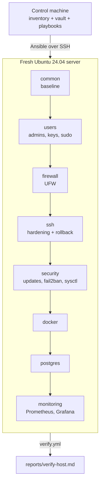

# bastion-infra

[](https://github.com/writchcraft/bastion-infra/actions/workflows/ci.yml)

Infrastructure automation for reproducibly turning a fresh Linux VM into a
configured, secured and monitored server.

```text
FRESH VM  →  ANSIBLE  →  CONFIGURED SERVER  →  VERIFIED  →  RUN AGAIN: changed=0
```

## Goal

Configuring one server by hand is easy. Doing it so the result is
**repeatable, documented, testable and predictable** is the actual job.
bastion-infra describes a hardened Ubuntu server as code: point it at a fresh
VM, run it, and the server ends up in a known state. Run it again and nothing
changes. Run the verification and the server proves it.

## What Bastion configures

| Area | What you get |
|---|---|
| **System baseline** | Hostname, timezone, locale, package baseline and upgrades, NTP, size-capped persistent journal; pending reboots reported, never forced |
| **Users** | Named admins from the inventory, SSH keys managed exclusively, per-user sudo rules validated with `visudo`, default `ubuntu` account locked |
| **SSH** | Key-only, no root, `AllowGroups` allow-list, verbose audit logging, applied with validation, a live login check and **automatic rollback** |
| **Firewall** | UFW deny-by-default, rate-limited SSH, service ports opened only when a service is exposed, every rule labelled |
| **Security** | Unattended security upgrades, fail2ban on the journal, a short documented sysctl set |
| **Docker** | Engine and Compose plugin from Docker's signed repo, validated `daemon.json`, log rotation, no TCP socket |
| **PostgreSQL** | PGDG packages, SCRAM auth, TLS-only remote access per database, validated config with restart only when required, nightly `pg_dump` timer |
| **Monitoring** | node_exporter, Prometheus and Grafana with a provisioned host dashboard and alert rules, without bypassing the firewall |
| **Verification** | 28 evidence-based checks (29 when default accounts are configured to be locked) and a Markdown report: services, effective config, open ports, endpoints, credentials |

## Architecture



Three playbooks, each with one job:

| Playbook | Connects as | Purpose |
|---|---|---|
| `bootstrap.yml` | image user (`ubuntu`) | Create admins, then **prove** key login and sudo work before anything is locked down |
| `server.yml` | admin | Apply all roles; idempotent |
| `verify.yml` | admin | Read-only checks, report, fail on critical problems |

What ends up running, and what is reachable:

| Port | Service | Default exposure |
|---|---|---|
| 22 | sshd | Public, rate-limited, keys only |
| 5432 | PostgreSQL | localhost; listed networks only, over TLS |
| 9090 | Prometheus | 127.0.0.1 |
| 9100 | node_exporter | 127.0.0.1 |
| 3000 | Grafana | 127.0.0.1, reached with `ssh -L` |

More in [docs/architecture.md](docs/architecture.md).

## Deployment flow

1. **Prepare a VM**: any fresh Ubuntu 24.04 server you can reach over SSH with a key (`scripts/dev-vm.sh up` creates one locally).
2. **Configure the inventory**: hosts in `hosts.yml`, environment settings in `group_vars/all/main.yml`.
3. **Configure variables**: admins, feature switches, service settings ([docs/configuration.md](docs/configuration.md)).
4. **Configure the vault**: `scripts/init-vault.sh <env>` generates and encrypts secrets ([docs/secrets.md](docs/secrets.md)).
5. **Run the playbooks**: `bootstrap.yml` once, then `server.yml`.
6. **Run verification**: `verify.yml` writes `reports/verify-<host>.md`.
7. **Rerun to confirm idempotency**: `scripts/idempotency-check.sh` fails if anything reports `changed`.

## Quick start

```bash
git clone https://github.com/writchcraft/bastion-infra.git
cd bastion-infra
python3 -m venv .venv && . .venv/bin/activate
make deps
```

Create a VM (or set `ansible_host` for your own in
`ansible/inventories/development/host_vars/bastion-dev.yml`):

```bash
scripts/dev-vm.sh up
```

Review `ansible/inventories/development/group_vars/all/main.yml`, then
generate secrets:

```bash
scripts/init-vault.sh development
export ANSIBLE_VAULT_PASSWORD_FILE=~/.config/bastion/development.vault-pass
```

Deploy, verify, and prove idempotency:

```bash
make bootstrap     # once: creates the admin user as "ubuntu"
make deploy        # ansible-playbook playbooks/server.yml
make verify        # ansible-playbook playbooks/verify.yml
make idempotency   # second run must report changed=0
```

Every `make` target is a thin wrapper that prints the `ansible-playbook`
command it runs. `make help` lists them.

## Roles

| Role | Responsibility |
|---|---|
| [`common`](ansible/roles/common) | Hostname (and stops cloud-init resetting it), timezone, locale, apt baseline and upgrades, timesyncd (or existing chrony), journald limits, reboot detection |
| [`users`](ansible/roles/users) | Validates and creates admins, exclusive authorized keys, `sshusers` group, per-user sudoers file, locks default accounts, never deletes home directories |
| [`firewall`](ansible/roles/firewall) | UFW defaults, SSH rule (rate-limited, source-restricted), extra and explicitly removed rules, keeps the current port open during SSH port moves |
| [`ssh`](ansible/roles/ssh) | Lockout guards, moves sshd off socket activation, drop-in config, validate, rollback timer, reload, fresh-login proof |
| [`security`](ansible/roles/security) | unattended-upgrades policy, fail2ban jail (tested before restart), kernel network parameters, optional service masking |
| [`docker`](ansible/roles/docker) | Docker CE repo (deb822), Engine and Compose, `daemon.json` validated by `dockerd --validate`, docker group, stack and data directories |
| [`postgres`](ansible/roles/postgres) | PGDG repo, cluster settings drop-in, templated `pg_hba.conf`, roles and databases, validate → reload → restart-if-pending handlers, backup timer |
| [`monitoring`](ansible/roles/monitoring) | node_exporter, Compose stack with host networking, `promtool`-validated config and alert rules, Grafana provisioning, vault-driven admin password |

## Security

The decisions that matter most (all explained in [docs/security.md](docs/security.md)):

- **Replacement access before removal.** Password and root logins are disabled only after a new key-based admin session has succeeded.
- **SSH changes can't strand you.** Each change is validated twice, applied, then confirmed by a fresh login from the control machine. A `systemd-run` timer rolls back unconfirmed changes after 5 minutes.
- **Docker can't silently bypass the firewall.** Published container ports skip UFW, so Bastion's containers use host networking with explicit bind addresses. `verify.yml` fails on any unexpected public listener.
- **No copy-pasted hardening.** OpenSSH's maintained crypto defaults are kept. Only sysctl values that differ from Ubuntu's defaults are set. Every setting has a reason in the docs.
- **Secrets stay secret.** Ansible Vault, placeholders rejected at runtime, `no_log` on sensitive tasks, passwords passed on stdin.
- **Least exposure by default.** Only SSH is public. PostgreSQL and Grafana open ports only when you list who may connect.

## Testing

| Check | Tool |
|---|---|
| YAML and Ansible style | `yamllint`, `ansible-lint` (production profile) |
| Playbook structure | `ansible-playbook --syntax-check` |
| Shell scripts | `shellcheck` |
| Real deployment | CI job on a GitHub `ubuntu-24.04` VM: bootstrap locally, then deploy over real SSH to itself |
| Does it work? | `verify.yml` (28 checks in the CI and development inventories; report shown on the run page and uploaded as an artifact) |
| Idempotency | second `server.yml` run in CI must report `changed=0`; the gate script has its own test (`scripts/test-idempotency-check.sh`) |

The CI target is a freshly created, throw-away GitHub runner VM, but it is
not a pristine image: it ships with Docker, PostgreSQL and other tools
preinstalled. The truly fresh path is the Multipass workflow in
[docs/demo.md](docs/demo.md). Why a VM and not containers, and what is not
covered: [docs/testing.md](docs/testing.md).

## Evidence

Two different things prove the claim, and they are not the same test:

| | GitHub Actions | Multipass VM |
|---|---|---|
| What it is | Automated run on a throw-away `ubuntu-24.04` runner (not a pristine image: Docker and PostgreSQL are preinstalled) | A genuinely fresh Ubuntu 24.04 VM created by `scripts/dev-vm.sh` |
| When | Every push to `main` and every pull request | Manually, on demand ([docs/demo.md](docs/demo.md)) |

**Automated (GitHub Actions).** The [workflow history](https://github.com/writchcraft/bastion-infra/actions/workflows/ci.yml)
shows the full lifecycle on every push. Each run:

- lints (`yamllint`, `ansible-lint`, syntax checks, `shellcheck`) and tests the idempotency gate itself;
- bootstraps an administrator, deploys over real SSH, and runs `verify.yml`;
- prints the verification report (one row per check) on the run's summary page and uploads it as the `verify-report` artifact;
- reruns `server.yml` through `idempotency-check.sh`, which exits non-zero and lists the offending tasks if anything reports `changed` or if no play recap is produced; the recap is shown on the run's summary page.

The CI inventory sets `common_upgrade_packages: false`, so a package that
Ubuntu publishes between the two deployments cannot cause a false
idempotency failure. The default (`true`) is unchanged for real deployments.

Run that proves it: [CI run #10, commit 0f85dc6](https://github.com/writchcraft/bastion-infra/actions/runs/40867840327)
(all steps green). The run summary page holds the report and the second-run
recap (`changed=0`).

**Manual (fresh Multipass VM).** Follow [docs/demo.md](docs/demo.md). Paste your
own captured output below when you have it.

<!-- EVIDENCE-TO-PASTE: output of `make verify` ("N/N checks passed") and
     `make idempotency` (play recap with changed=0) from a fresh Multipass VM.
     Replace this comment with a fenced text block. Do not edit the output. -->

Terminal captures and a Grafana screenshot are not part of the repository.

## Project structure

```text
bastion-infra/
├── ansible/
│   ├── ansible.cfg
│   ├── inventories/
│   │   ├── development/          one local VM (Multipass)
│   │   ├── production.example/   template for real environments
│   │   └── ci/                   GitHub Actions runner
│   ├── playbooks/
│   │   ├── bootstrap.yml
│   │   ├── server.yml
│   │   ├── verify.yml
│   │   ├── group_vars/all.yml    project constants
│   │   ├── tasks/preflight.yml   shared safety checks
│   │   └── templates/            verification report
│   └── roles/                    common, users, firewall, ssh, security, docker, postgres, monitoring
├── docs/                         architecture, security, configuration, secrets, testing, troubleshooting, demo
├── scripts/
│   ├── dev-vm.sh                 create/destroy a local Ubuntu VM
│   ├── init-vault.sh             generate an encrypted vault with random secrets
│   └── idempotency-check.sh      fail if a rerun changes anything
├── .github/workflows/ci.yml      lint, syntax, converge, verify, idempotency
├── LICENSE
├── Makefile
├── requirements.yml              Ansible collections
└── requirements-dev.txt          control-node tooling
```

## Supported platforms

- **Target:** Ubuntu Server 24.04 LTS (amd64, arm64). Preflight refuses anything else.
- **Control machine:** Linux, macOS or WSL2 with Python 3.10+, ansible-core 2.17–2.18.

## Limitations

- One distribution. The roles keep distribution-specific parts contained so others can be added ([architecture](docs/architecture.md#adding-another-distribution)).
- PostgreSQL uses Debian's self-signed certificate: TLS is required for remote clients, but not verifiable.
- Backups stay on the server's own disk.
- Alerts are visible in Prometheus and Grafana but not routed anywhere.
- UFW rules removed from configuration must be listed once in `firewall_removed_rules`.
- Grafana is reached through an SSH tunnel unless you expose it yourself; no TLS reverse proxy is included.

## Future work

- **Terraform provisioning layer** (Proxmox or a cloud provider), with a strict split: Terraform creates the VM and network, Ansible configures it, `verify.yml` proves it.
- Off-host backups (restic or pgBackRest to object storage) with a scheduled restore test.
- Alertmanager with routing to email or chat.
- Caddy or nginx reverse proxy with automatic TLS for Grafana.
- postgres_exporter and cAdvisor for database and container metrics.
- Centralised logs (Loki or Vector).
- A second distribution (Debian 12) in the CI matrix.
- An opt-in, documented CIS-aligned role.

## License

[MIT](LICENSE) © 2026 writchcraft
