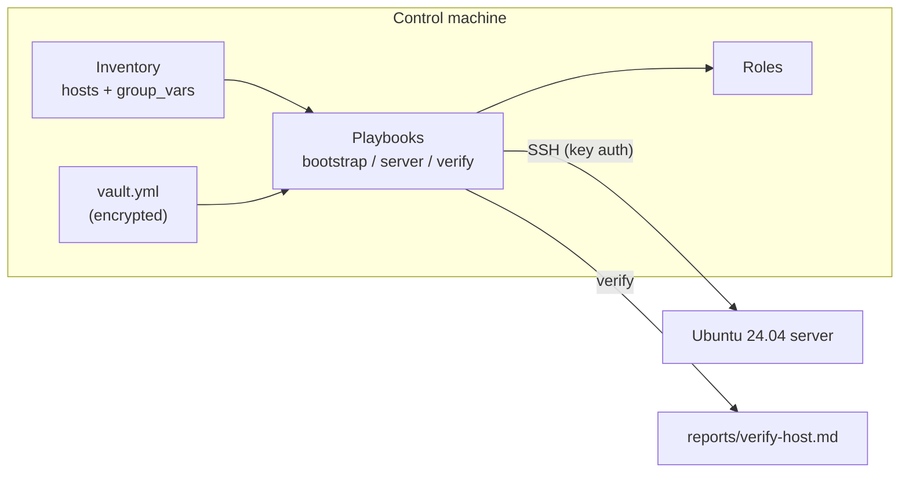
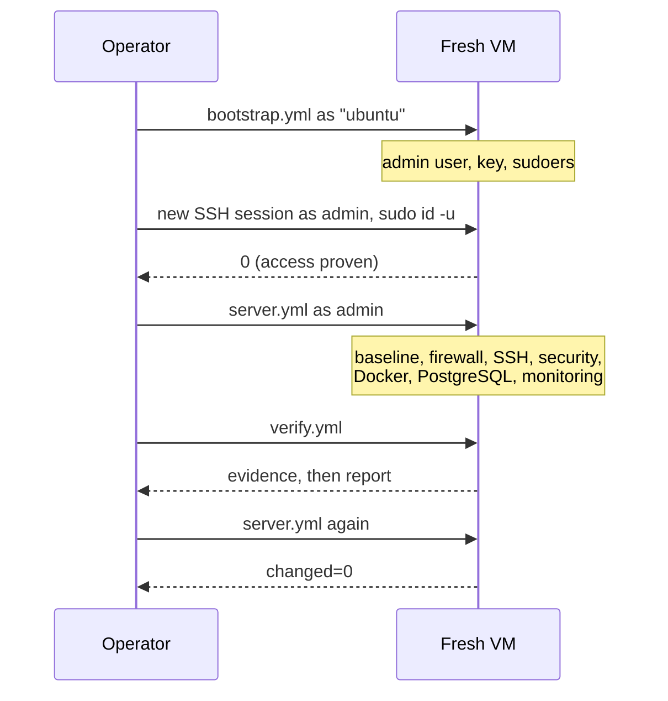
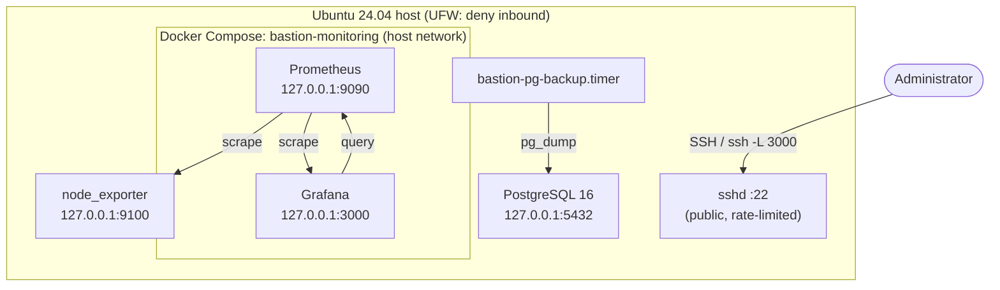

# Architecture

## Overview

bastion-infra has three layers:

| Layer | Location | Responsibility |
|---|---|---|
| Playbooks | `ansible/playbooks/` | The three operations: bootstrap, deploy, verify |
| Roles | `ansible/roles/` | One concern each, with defaults that work out of the box |
| Inventories | `ansible/inventories/` | Hosts, environment configuration and (encrypted) secrets |

Roles never contain environment-specific values. Inventories never contain
logic. The only project-wide constant (the supported Ubuntu releases) lives in
`ansible/playbooks/group_vars/all.yml`.



## The three playbooks

| Playbook | Connects as | Changes the server? | Purpose |
|---|---|---|---|
| `bootstrap.yml` | the image's default user (`bootstrap_user`) | yes: users only | Create administrators, then prove key login and sudo work as one of them |
| `server.yml` | the administrator (`bastion_admin_user`) | yes | Apply every role; safe to run repeatedly |
| `verify.yml` | the administrator | no | Collect evidence, evaluate checks, write a report, fail on critical problems |

Bootstrap is a separate playbook because the first connection uses
credentials that the hardening will later remove: a cloud image's `ubuntu`
user, or a provider's root password. Its second play opens a new SSH session
as the administrator and checks that `sudo` returns root. Only once that
replacement access is proven does `server.yml` disable password logins.



## Roles

| Role | Responsibility | Key outputs |
|---|---|---|
| `common` | Hostname, timezone, locale, apt baseline, upgrades, time sync, journald limits | Predictable base system; pending reboots reported, not forced |
| `users` | Admin accounts, SSH keys, sudo rules, SSH access group, locking default accounts | `/etc/sudoers.d/bastion-admins`, `sshusers` group |
| `firewall` | UFW policy, SSH rule, extra and removed rules | Default deny inbound; SSH rate-limited |
| `ssh` | sshd policy as a drop-in, socket activation off, guarded apply with rollback | `/etc/ssh/sshd_config.d/00-bastion.conf` |
| `security` | Unattended security upgrades, fail2ban, kernel network parameters, optional service masking | `/etc/fail2ban/jail.d/bastion.local`, `/etc/sysctl.d/60-bastion.conf` |
| `docker` | Docker Engine and Compose from Docker's repository, daemon config, group membership | `/etc/docker/daemon.json`, `/opt/bastion`, `/var/lib/bastion` |
| `postgres` | PostgreSQL from PGDG, config drop-in, `pg_hba.conf`, roles, databases, backups | Cluster `16/main`, nightly `pg_dump` timer |
| `monitoring` | node_exporter (native), Prometheus and Grafana (Compose), provisioning, alert rules | Grafana dashboard "Bastion host overview" |

Execution order in `server.yml` is part of the design:

1. **common** first, so later roles can rely on packages such as `acl` and `python3-debian`.
2. **users** before anything that restricts logins.
3. **firewall before ssh**, so that if `ssh_port` changes, the new port is open before sshd moves to it.
4. **docker before monitoring**: the docker role flushes its handlers, so a daemon restart happens before containers are deployed.

Optional roles are switched with `enable_docker`, `enable_postgres` and
`enable_monitoring`. Preflight refuses `enable_monitoring` without
`enable_docker`.

## What runs on the server



### Ports

| Port | Service | Bound to (default) | Open in UFW | Why |
|---|---|---|---|---|
| 22/tcp | sshd | all addresses | yes (`limit`) | Administration; the only public service by default |
| 5432/tcp | PostgreSQL | localhost | only for `postgres_allowed_networks` | Local apps by default; remote clients must be listed and use TLS |
| 9090/tcp | Prometheus | 127.0.0.1 | no | Internal; reached through Grafana or an SSH tunnel |
| 9100/tcp | node_exporter | 127.0.0.1 | no | Only Prometheus needs it |
| 3000/tcp | Grafana | 127.0.0.1 | only for `monitoring_grafana_allowed_sources` | SSH tunnel by default; opt-in exposure |

`verify.yml` checks this table against reality: any TCP listener on a
non-loopback address that is not expected fails verification.

### Filesystem layout

| Path | Contents |
|---|---|
| `/etc/ssh/sshd_config.d/00-bastion.conf` | SSH policy (Ubuntu's `sshd_config` is untouched) |
| `/etc/sudoers.d/bastion-admins` | Passwordless sudo grants, one line per admin |
| `/etc/docker/daemon.json` | Log rotation and live-restore |
| `/opt/bastion/monitoring/` | Compose project, Prometheus config and rules, Grafana provisioning |
| `/var/lib/bastion/monitoring/` | Prometheus TSDB and Grafana database (persistent) |
| `/etc/postgresql/16/main/conf.d/90-bastion.conf` | PostgreSQL settings drop-in |
| `/var/lib/postgresql/16/main/` | PostgreSQL data (Debian default) |
| `/var/backups/postgresql/` | Nightly dumps, mode 0700, owned by `postgres` |

## Design decisions

### Drop-in files instead of rewriting packaged config

sshd, journald, timesyncd, apt, fail2ban and PostgreSQL all support
configuration directories. Bastion writes its own file into each one rather
than templating the distribution's main file. Package upgrades never conflict
with Ansible, and anyone reading the server can see exactly what Bastion
changed. `pg_hba.conf` is the exception: PostgreSQL has no include mechanism
for it, so it is fully templated (with a backup), reproducing the Debian
defaults plus the configured remote rules.

### SSH changes are a guarded sequence, not a handler

A handler runs at the end of the play, after unrelated roles, and cannot
prove that access survived. The ssh role instead:

1. validates the new drop-in on its own (`sshd -t -f`);
2. arms a `systemd-run` timer that restores the previous file after 5 minutes;
3. validates the complete configuration (`sshd -t`) and reloads sshd;
4. opens a brand-new SSH connection from the control machine (bypassing Ansible's multiplexed session);
5. disarms the timer.

If step 3 or 4 fails, the role rolls back immediately. If the control
machine loses contact entirely, the timer rolls back on its own.

### sshd without socket activation

Ubuntu 24.04 starts sshd through `ssh.socket`. In that mode `Port` and
`ListenAddress` are read by a systemd generator, and changing them needs
`daemon-reload` plus a socket restart. The ssh role switches to the classic
`ssh.service`, so `sshd_config` is the single source of truth and reload
semantics match every other Linux server. The switch has a rescue block that
re-enables the socket if the service fails to start, and existing sessions
survive because `ssh.service` uses `KillMode=process`.

### PostgreSQL runs natively, monitoring runs in Docker

PostgreSQL is the stateful service with the most to lose. Native packages
give it systemd supervision, `pg_ctlcluster`, Debian's cluster tooling,
security updates from PGDG, and no Docker networking in the data path.
The role also demonstrates the operations work a database needs:
authentication, network exposure, validated configuration and backups.

The monitoring stack is stateless apart from metrics history, version-pinned,
and easiest to upgrade as images, so it runs under Docker Compose. That makes
the Docker role useful rather than decorative.

### Monitoring uses host networking

Docker publishes container ports by inserting its own iptables rules, which
take effect before UFW's rules. A Compose file with `ports: ["3000:3000"]`
would expose Grafana to the internet even with UFW denying 3000. Running
Prometheus and Grafana with `network_mode: host` and explicit listen
addresses means there are no published ports at all, so UFW remains the
single authority on exposure. node_exporter runs natively because it reads
host metrics; a containerised exporter would need broad host mounts.

### Verification is a separate, read-only playbook

Ansible exiting 0 means every task's module succeeded, not that the server
works. `verify.yml` inspects the running system (effective sshd config,
UFW status, listening sockets, HTTP endpoints, database contents) and treats
each check as evidence. It collects everything before evaluating, writes a
report, and fails only at the end, so one broken service never hides the
state of the others.

### Configuration layering

```text
role defaults/main.yml       lowest: sensible, environment-neutral defaults
inventory group_vars/all/    environment configuration (main.yml) and secrets (vault.yml)
inventory host_vars/         per-host overrides
role vars/main.yml           derived values that are not meant to be overridden
extra vars (-e)              one-off overrides
```

Environment files use friendly names from the project brief (`server_timezone`,
`ssh_port`, `enable_docker`). Roles map them onto prefixed variables, for
example `common_timezone: "{{ server_timezone | default('Etc/UTC') }}"`. Each
role stays self-contained, while an environment file reads like a description
of the server.

## Adding another distribution

Only Ubuntu 24.04 is supported and tested. The distribution-specific parts are
concentrated in a few places: apt and deb822 repositories in `common`,
`docker` and `postgres`, the `ssh` service name, and package names. A second
distribution would add `vars/<distribution>.yml` files loaded with
`include_vars` and `first_found`, plus package-manager branches. The preflight
assertion lists supported versions in one place.
